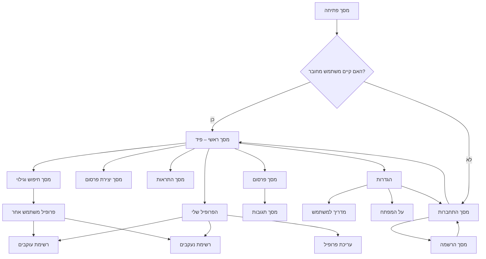
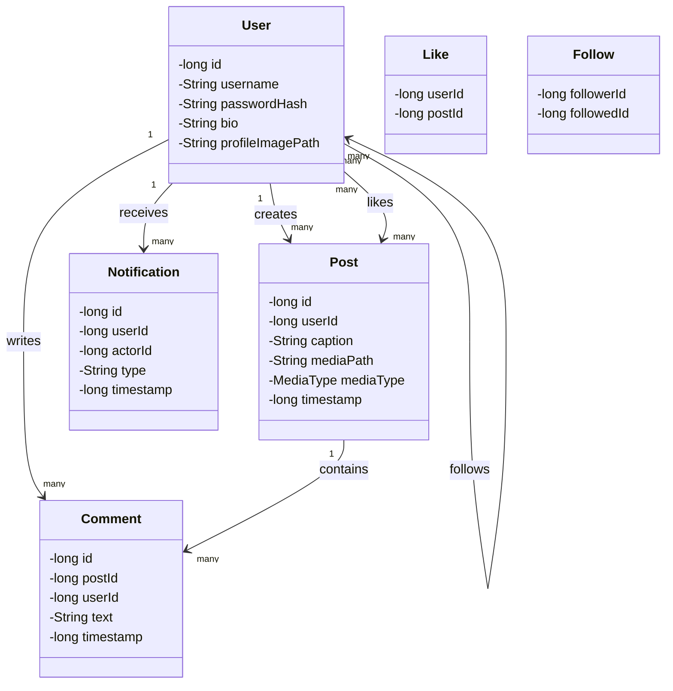

# שער

לוגו בית הספר: (יש להוסיף לוגו בית הספר)

שם בית הספר: (להשלים)

שם העבודה: MineNet -- אפליקציית רשת חברתית למכשירי Android

שם התלמיד: (להשלים)

ת.ז. התלמיד: (להשלים)

שם המנחה: (להשלים)

שם החלופה: (להשלים בהתאם להנחיות בית הספר)

תאריך ההגשה: (להשלים)

---

# תוכן עניינים
- [שער](#שער)
- [תוכן עניינים](#תוכן-עניינים)
- [מבוא](#מבוא)
    - [הרקע לפרויקט](#הרקע-לפרויקט)
    - [תהליך המחקר](#תהליך-המחקר)
    - [אתגרים מרכזיים](#אתגרים-מרכזיים)
    - [חידושים והתאמות](#חידושים-התאמות-ועדכונים)
    - [תיאור תחום הידע - פרק מילולי](#תיאור-תחום-הידע---פרק-מילולי)
- [מבנה וארכיטקטורה](#מבנה--ארכיטקטורה-של-הפרויקט)
    - [תיאור מסך הפתיחה](#תיאור-מסך-הפתיחה---מה-הוא-מכיל-והאם-משמש-נקודת-ניווט)
    - [תכנון המסכים](#שלב-תכנון-ותיעוד-מסכי-הפרויקט)
    - [תרשים זרימת מסכים](#תרשים-מסכים-המתאר-את-היררכיית-המסכים-והמעברים-ביניהם-screen-flow-diagram)
    - [תיאור מחלקות ו-UML](#תיאור-מחלקות-הפרויקט)
- [מימוש הפרויקט](#מימוש-הפרויקט)
    - [תיעוד מחלקות](#שם-מחלקה-user)
    - [בסיס נתונים](#בסיס-נתונים)
- [מדריך למשתמש](#מדריך-למשתמש)
    - [סביבת בדיקה](#גרסאות-עליהם-נבדק-הפרויקט)
    - [אופן השימוש](#תיאור-אופן-הפעולה-של-הפרויקט)
    - [הודעות למשתמש](#הודעות-למשתמש)
- [סיכום אישי ורפלקציה](#סיכום-אישי--רפלקציה)
- [ביבליוגרפיה](#ביבליוגרפיה)
- [נספחים](#נספחים)

---

# מבוא

## הרקע לפרויקט

### שם הפרויקט
MineNet -- אפליקציית רשת חברתית למכשירי Android.

### תיאור קצר של הפרויקט
MineNet היא אפליקציית רשת חברתית למכשירי Android, שמטרתה לאפשר למשתמשים ליצור פרופיל אישי, לפרסם תכנים ולבצע פעולות חברתיות מול משתמשים אחרים. האפליקציה מתוכננת לכלול פרסומים מסוגים שונים, ובהם טקסט, תמונות וסרטונים. משתמש יוכל לצפות בפיד, לפתוח פרסומים, לסמן לייק, לכתוב תגובות, לחפש משתמשים, להיכנס לפרופילים שלהם ולעקוב אחריהם.

האפליקציה תפותח ב-Android Studio בשפת Java, וממשקי המשתמש שלה ייבנו באמצעות קובצי XML. בשלב המתוכנן של הפרויקט, הנתונים יישמרו באופן מקומי באמצעות SQLite, וקובצי המדיה יישמרו באחסון המקומי של המכשיר. לכן, גרסת הפרויקט המקומית לא תסנכרן פרסומים או משתמשים בין מכשירים שונים. מטרת המימוש היא להדגים את התהליכים והיכולות המרכזיים של רשת חברתית בסביבה מקומית.

### קהל היעד
קהל היעד הוא משתמשי Android המעוניינים להתנסות בסביבת רשת חברתית שבה ניתן ליצור פרופיל, לפרסם תוכן, לצפות בפרסומים ולבצע אינטראקציות חברתיות. במסגרת הפרויקט, האפליקציה מיועדת בעיקר להדגמה ולשימוש מקומי במכשיר שעליו מותקנת האפליקציה.

### הסיבות לבחירת הנושא
בחרתי בנושא זה מתוך עניין בפיתוח תוכנה ובבניית יישומים המשלבים ממשק משתמש, תכנות מונחה עצמים וניהול מידע. רשת חברתית היא מערכת שמורכבת ממספר תתי-מערכות הקשורות זו בזו: משתמשים, פרסומים, תגובות, לייקים וקשרי מעקב. פיתוח MineNet יאפשר לי לתכנן את הקשרים בין רכיבי המערכת, לעבוד עם מסד נתונים, לנהל קובצי מדיה ולפתח ממשק Android מלא.

---

## תהליך המחקר

### נקודות עיקריות במחקר לצורכי הפרויקט
המחקר המקדים לפרויקט מתמקד באופן שבו רשתות חברתיות מארגנות מידע ומאפשרות למשתמשים לפרסם תוכן ולתקשר זה עם זה. לצורך תכנון MineNet נדרש לבחון את מבנה הפרופילים, הפיד, הפרסומים, התגובות, הלייקים ומערכת העוקבים. בנוסף, נדרש ללמוד כיצד אפליקציית Android שומרת מידע וקובצי מדיה במכשיר וכיצד ניתן להציג אותם בצורה נוחה.

### מחקר על תחום ידע
הפרויקט משלב כמה תחומי ידע:
- **פיתוח Android ב-Java:** יצירת Activities ו-Fragments, טיפול באירועי משתמש, מעבר בין מסכים וניהול מחזור החיים של רכיבי Android.
- **עיצוב ממשק באמצעות XML:** הגדרת פריסות, רכיבי תצוגה, שדות קלט, כפתורים ורשימות.
- **SQLite:** מסד נתונים יחסי מקומי המאפשר לשמור מידע בטבלאות, להגדיר מפתחות ראשיים וזרים ולבצע פעולות SQL.
- **תכנות מונחה עצמים:** ייצוג ישויות כמו משתמש, פרסום ותגובה באמצעות מחלקות נפרדות.
- **אחסון קבצים:** שמירת תמונות וסרטונים במכשיר ושמירת הנתיב לקובץ ברשומת הפרסום.
- **השאות ובחירת מדיה:** מתן אפשרות למשתמש לבחור תמונות וסרטונים מהמכשיר בהתאם למנגנוני Android.

*(יש להשלים סעיף זה לאחר הלמידה בפועל ולציין אילו נושאים נלמדו באופן עצמאי ואילו מקורות שימשו לכך.)*

### בדיקת אפליקציות קיימות
לצורך גיבוש הרעיון ניתן לבחון אפליקציות חברתיות מוכרות, למשל Instagram, Reddit ו-Facebook. הבדיקה יכולה להתמקד באופן הצגת הפיד, מבנה הפרופיל, יצירת פרסום, הצגת תגובות וניווט בין משתמשים.

מטרת ההשוואה אינה להעתיק אפליקציה קיימת, אלא לזהות דפוסי שימוש נפוצים ולבחור אילו מהם מתאימים להיקף של MineNet. *(יש להשלים כאן תצפיות אישיות לאחר בדיקה בפועל של האפליקציות.)*

### סקירת המצב הקיים בשוק
בשוק קיימות רשתות חברתיות רבות המאפשרות שיתוף תוכן ויצירת קשרים בין משתמשים. חלקן מתמקדות בתמונות ובסרטונים, אחרות בקהילות ובדיונים, ורבות משלבות כמה סוגי תוכן. MineNet מתבססת על רעיונות מרכזיים אלה, אך במסגרת הפרויקט תפותח גרסה מצומצמת ומקומית שמטרתה להדגים את המנגנונים הבסיסיים של רשת חברתית.

---

## אתגרים מרכזיים

### בעיות שהלומד התמודד איתן במהלך פיתוח הפרויקט
בשלב התכנון זוהו מספר אתגרים טכנולוגיים שיידרשו טיפול במהלך הפיתוח:
1. **תכנון מסד הנתונים:** הגדרת טבלאות וקשרים בין משתמשים, פרסומים, תגובות, לייקים ועוקבים.
2. **ניהול מדיה:** בחירת תמונות וסרטונים, שמירתם במכשיר והצגתם בפרסומים.
3. **הצגת פיד:** טעינת מספר פרסומים והצגתם ברשימה תוך שמירה על ביצועים סבירים.
4. **שמירת עקביות:** מניעת כפילויות, למשל לייק כפול של אותו משתמש לאותו פרסום.
5. **ניווט:** מעבר בין הפיד, פרופילים, מסכי פרסום, תגובות וחיפוש.
6. **אימות משתמש מקומי:** ניהול חשבונות במכשיר והגנה בסיסית על פרטי ההתחברות.

*(יש לעדכן סעיף זה במהלך העבודה ולתאר בעיות שהתעוררו בפועל ואת דרכי הפתרון שנבחרו.)*

### על איזה צורך הפרויקט עונה / איזה פתרון הפרויקט הזה בא לתת
MineNet נועדה להדגים כיצד ניתן לבנות אפליקציה המאגדת במקום אחד פרופילים אישיים, פרסומים ואינטראקציות חברתיות. הפרויקט מספק סביבת תרגול שבה ניתן ליצור משתמשים מקומיים, לפרסם תוכן, לעקוב אחר משתמשים אחרים ולצפות בפיד המבוסס על קשרי המעקב. אין מדובר בשירות חברתי מקוון מלא: בגרסה המקומית המידע נשמר במכשיר ואינו משותף אוטומטית עם מכשירים אחרים.

### הצגת פתרונות לבעיה (הפתרונות שנבחנו במסגרת המחקר המקדים)
בשלב התכנון נשקלו שתי גישות עיקריות לשמירת המידע:
- **מסד נתונים מקומי:** שמירת המשתמשים, הפרסומים והאינטראקציות במכשיר באמצעות SQLite.
- **שרת ומסד נתונים מרוחק:** שמירת המידע בשרת מרכזי, כך שמשתמשים ממכשירים שונים יוכלו לשתף מידע.

נבחרה בשלב זה גישה מקומית המבוססת על SQLite, בהתאם להחלטה לפתח את הפרויקט ללא שירות Backend חיצוני. בחירה זו מפשטת את התשתית ומאפשרת להתמקד בפיתוח האפליקציה ובמבנה הנתונים. החיסרון הוא שאין סנכרון בין מכשירים.

---

## חידושים, התאמות ועדכונים של אלמנטים טכנולוגיים, עיצוביים ואחרים בפרויקט
MineNet משלבת מספר סוגי תוכן בממשק אחד: טקסט, תמונות וסרטונים. בנוסף, היא מחברת בין מערכת פרסומים לבין מערכת קשרים חברתיים, כך שהפיד יוכל להציג תוכן בהתאם למשתמשים שאחריהם המשתמש עוקב. הפרויקט יתוכנן בצורה מודולרית, כדי לאפשר הוספת סוגי פרסומים ותכונות נוספות בעתיד.

החידוש בפרויקט הוא בעיקר במימוש העצמאי של רכיבי רשת חברתית ובשילובם באפליקציית Android מקומית, ולא בהצגת טכנולוגיה חדשה שלא קיימת בשוק.

---

## תיאור תחום הידע - פרק מילולי

### אובייקטים נחוצים
האובייקטים המרכזיים במערכת הם:
- **User (משתמש):** מייצג חשבון באפליקציה וכולל מזהה, שם משתמש, פרטי פרופיל ונתיב לתמונת פרופיל.
- **Post (פרסום):** מייצג תוכן שפורסם על ידי משתמש וכולל מזהה, מזהה מפרסם, כיתוב, סוג מדיה, נתיב לקובץ ותאריך יצירה.
- **Comment (תגובה):** מייצגת תגובה לפרסום וכוללת מזהה תגובה, מזהה פרסום, מזהה כותב, תוכן ותאריך.
- **Like (לייק):** מייצג קשר בין משתמש לפרסום שעליו לחץ לייק.
- **Follow (מעקב):** מייצג קשר שבו משתמש אחד עוקב אחר משתמש אחר.
- **Notification (התראה):** מייצגת אירוע שהמערכת מעוניינת להציג למשתמש, כגון לייק, תגובה או מעקב חדש.

### סוגי נתונים
המערכת תשתמש בסוגי הנתונים הבאים:

| סוג נתון | שימוש |
| :--- | :--- |
| `int` / `long` | מזהים, מונים וחותמות זמן |
| `String` | שמות משתמש, סיסמאות, תיאורים, תגובות ונתיבי קבצים |
| `boolean` | מצבים לוגיים, כגון האם פעולה בוצעה |
| `enum` או ערך טקסט מוגדר | סוג הפרסום: טקסט, תמונה או סרטון |
| `Uri` / נתיב קובץ | הפניה לקובץ מדיה במכשיר |

ב-SQLite ייעשה שימוש בטיפוסים המתאימים, כגון `INTEGER`, `TEXT` ו-`REAL`, לפי הצורך.

### ייצוג מידע
המידע ייוצג באמצעות מחלקות Java ובאמצעות טבלאות במסד נתונים יחסי מסוג SQLite.

הקשרים העיקריים יהיו:
- משתמש אחד יכול ליצור פרסומים רבים.
- פרסום אחד יכול להכיל תגובות רבות.
- משתמש יכול לסמן לייק לפרסומים רבים, ופרסום יכול לקבל לייקים ממשתמשים רבים.
- משתמש יכול לעקוב אחר משתמשים רבים, ומשתמש יכול להיות במעקב של משתמשים רבים.

טבלת `Likes` תשתמש בצירוף של `user_id` ו-`post_id` כדי לייצג לייק יחיד של משתמש לפרסום. טבלת `Followers` תשתמש ב-`follower_id` וב-`followed_id` כדי לייצג קשר מעקב. מומלץ להגדיר מפתחות זרים ואילוצים למניעת רשומות כפולות.

### תיאור פעולות על המידע
המערכת תבצע את הפעולות הבאות:
- **הוספה:** יצירת משתמש, פרסום חדש, תגובה, לייק או קשר מעקב.
- **שליפה:** הצגת פרופיל, טעינת פרסומים, הצגת תגובות וחיפוש משתמשים.
- **עדכון:** שינוי פרטי פרופיל, תיאור משתמש או פרטי פרסום בהתאם להרשאות.
- **מחיקה:** מחיקת פרסום, תגובה, לייק או קשר מעקב.
- **שאילתות מורכבות:** הצגת הפיד על בסיס קשרי המעקב, ספירת לייקים ותגובות והצגת רשימות עוקבים.

---

# מבנה / ארכיטקטורה של הפרויקט

הפרויקט יחולק לשלוש שכבות עיקריות: שכבת ממשק המשתמש, שכבת הלוגיקה ושכבת הגישה לנתונים. שכבת הממשק תציג את המסכים ותקלוט פעולות מהמשתמש. שכבת הלוגיקה תטפל בכללי המערכת, כגון יצירת פרסום ובדיקת קשרי מעקב. שכבת הגישה לנתונים תבצע פעולות מול SQLite ותטפל בשמירת קובצי המדיה במכשיר.

## תיאור מסך הפתיחה - מה הוא מכיל והאם משמש נקודת ניווט
מסך הפתיחה יציג את שם האפליקציה MineNet ואת הלוגו שלה בזמן טעינת המערכת. לאחר סיום הטעינה, האפליקציה תבדוק אם קיים משתמש מחובר. אם כן, המשתמש יועבר למסך הראשי. אם לא, הוא יועבר למסך ההתחברות. מסך הפתיחה משמש מסך מעבר ואינו מיועד לביצוע פעולות חברתיות.

## שלב תכנון ותיעוד מסכי הפרויקט
המסכים הבאים הם מסכי התכנון של MineNet. יש לעדכן את התיאורים ואת התמונות בהתאם למימוש הסופי.

- **מסך התחברות**
  - **תפקיד:** לאפשר למשתמש קיים להיכנס לחשבונו המקומי.
  - **מידע ורכיבים:** שדה שם משתמש או כתובת דוא"ל, שדה סיסמה, כפתור התחברות וקישור למסך הרשמה. יוצגו הודעות במקרה של פרטים שגויים או שדות חסרים.
  - **תמונת מסך:** *(להוסיף צילום מסך לאחר המימוש)*

- **מסך הרשמה**
  - **תפקיד:** יצירת משתמש חדש במכשיר.
  - **מידע ורכיבים:** שדות להזנת שם משתמש, סיסמה ואישור סיסמה, וכן פרטים נוספים שיוגדרו במהלך הפיתוח. בעת ההרשמה תיבדק תקינות הנתונים ושם המשתמש ייבדק מול המשתמשים הקיימים במסד הנתונים.
  - **תמונת מסך:** *(להוסיף צילום מסך לאחר המימוש)*

- **מסך ראשי - פיד**
  - **תפקיד:** הצגת הפרסומים הזמינים למשתמש.
  - **מידע ורכיבים:** רשימת פרסומים הכוללת שם מפרסם, תמונת פרופיל, תוכן או מדיה, כיתוב, מספר לייקים וכפתור תגובות. הפיד יתבסס על הפרסומים של המשתמשים שאחריהם המשתמש עוקב.
  - **תמונת מסך:** *(להוסיף צילום מסך לאחר המימוש)*

- **מסך יצירת פרסום**
  - **תפקיד:** לאפשר למשתמש ליצור פרסום חדש.
  - **מידע ורכיבים:** שדה כיתוב, אפשרות לבחור תמונה או סרטון מהמכשיר וכפתור פרסום. ניתן יהיה ליצור גם פרסום טקסטואלי ללא קובץ מדיה.
  - **תמונת מסך:** *(להוסיף צילום מסך לאחר המימוש)*

- **מסך פרסום ותגובות**
  - **תפקיד:** הצגת פרסום יחיד והאינטראקציות הקשורות אליו.
  - **מידע ורכיבים:** תוכן הפרסום, פרטי המפרסם, כפתור לייק, מספר לייקים, רשימת תגובות ושדה להוספת תגובה. משתמש יוכל להיכנס לפרופיל המפרסם מתוך המסך.
  - **תמונת מסך:** *(להוסיף צילום מסך לאחר המימוש)*

- **מסך חיפוש וגילוי**
  - **תפקיד:** לאפשר למשתמש למצוא משתמשים אחרים.
  - **מידע ורכיבים:** שדה חיפוש ורשימת תוצאות הכוללת שמות משתמש ותמונות פרופיל. בחירת תוצאה תפתח את פרופיל המשתמש.
  - **תמונת מסך:** *(להוסיף צילום מסך לאחר המימוש)*

- **מסך פרופיל אישי**
  - **תפקיד:** הצגת פרטי המשתמש והפרסומים שיצר.
  - **מידע ורכיבים:** תמונת פרופיל, שם משתמש, תיאור אישי, מספר עוקבים, מספר משתמשים במעקב ורשימת הפרסומים. בפרופיל של המשתמש המחובר תופיע גם אפשרות לעריכת הפרופיל.
  - **תמונת מסך:** *(להוסיף צילום מסך לאחר המימוש)*

- **מסך פרופיל של משתמש אחר**
  - **תפקיד:** הצגת פרופיל של משתמש אחר ומתן אפשרות לעקוב אחריו.
  - **מידע ורכיבים:** תמונת פרופיל, שם משתמש, תיאור, מספר עוקבים, מספר משתמשים במעקב, פרסומים וכפתור מעקב או ביטול מעקב.
  - **תמונת מסך:** *(להוסיף צילום מסך לאחר המימוש)*

- **מסך עוקבים ונעקבים**
  - **תפקיד:** הצגת רשימות המשתמשים שעוקבים אחר משתמש מסוים והמשתמשים שאחריהם הוא עוקב.
  - **מידע ורכיבים:** רשימת משתמשים עם שמות ותמונות פרופיל. בחירה במשתמש תפתח את הפרופיל שלו.
  - **תמונת מסך:** *(להוסיף צילום מסך לאחר המימוש)*

- **מסך התראות**
  - **תפקיד:** הצגת פעולות שבוצעו ביחס למשתמש.
  - **מידע ורכיבים:** רשימת אירועים כגון לייקים, תגובות ומעקבים חדשים. התראות יישמרו באופן מקומי.
  - **תמונת מסך:** *(להוסיף צילום מסך לאחר המימוש)*

- **מסך הגדרות, מדריך למשתמש ועל המפתח**
  - **תפקיד:** מתן גישה להגדרות בסיסיות, להסבר על השימוש באפליקציה ולמידע על מפתח הפרויקט.
  - **מידע ורכיבים:** אפשרויות כגון התנתקות, פתיחת מדריך למשתמש, הצגת פרטי הפרויקט ומידע על המפתח.
  - **תמונת מסך:** *(להוסיף צילום מסך לאחר המימוש)*

---

## תרשים מסכים המתאר את היררכיית המסכים והמעברים ביניהם (Screen Flow Diagram)

---

## תיאור מחלקות הפרויקט
המחלקות הבאות הן הצעה ראשונית לתכנון. שמות המחלקות והאחריות שלהן עשויים להשתנות במהלך המימוש.

### תיאור UML של המחלקות לרבות קשרים ביניהם

---

# מימוש הפרויקט

*הערה: הפרויקט נמצא בשלב התכנון לפי המידע שנמסר עד כה. לכן סעיף זה מתאר מימוש מתוכנן. לאחר כתיבת הקוד יש לעדכן את התיעוד כך שישקף את המחלקות, השדות והפעולות שקיימים בפועל.*

## שם מחלקה: User

### תפקיד המחלקה
המחלקה `User` מייצגת משתמש במערכת. היא מרכזת את פרטי המשתמש ומשמשת להעברת נתוני משתמש בין שכבת מסד הנתונים לבין שכבת הלוגיקה וממשק המשתמש.

### הסבר תכונות המחלקה
- **תחום גישה:** התכונות המתוכננות יהיו פרטיות (`private`) כדי לשמור על עקרון הכימוס.
- **תפקיד ושימוש:**
  - `id` -- מזהה ייחודי של המשתמש במסד הנתונים.
  - `username` -- שם המשתמש המוצג באפליקציה.
  - `passwordHash` -- גיבוב של הסיסמה, ולא הסיסמה המקורית.
  - `bio` -- תיאור קצר של המשתמש.
  - `profileImagePath` -- נתיב לתמונת הפרופיל באחסון המקומי.

### הסבר קצר של הפעולות במחלקה
הפעולות המתוכננות כוללות בנאי לקבלת פרטי משתמש, פעולות גישה (`get`) ועדכון (`set`) לתכונות, ופעולות עזר לבדיקת תקינות נתונים לפי הצורך.

---

## מחלקות נוספות מתוכננות

| מחלקה | תפקיד |
| :--- | :--- |
| `Post` | ייצוג פרסום ותכני המדיה שלו |
| `Comment` | ייצוג תגובה לפרסום |
| `Like` | ייצוג לייק של משתמש לפרסום |
| `Follow` | ייצוג קשר מעקב בין משתמשים |
| `Notification` | ייצוג התראה מקומית |
| `DatabaseHelper` | יצירה וניהול של מסד הנתונים וטבלאות SQLite |
| `UserRepository` | פעולות שליפה, הוספה ועדכון של משתמשים |
| `PostRepository` | פעולות על פרסומים |
| `FollowRepository` | פעולות על קשרי מעקב |
| `AuthManager` | טיפול בהרשמה, התחברות והתנתקות מקומית |
| `MediaManager` | בחירת קבצים, שמירתם וניהול נתיבי מדיה |

---

## בסיס נתונים

### סקירת בסיס הנתונים
MineNet תשתמש ב-SQLite, מסד נתונים יחסי המוטמע במכשיר Android. הנתונים יישמרו מקומית ולא יידרש שרת חיצוני. מסד הנתונים יכיל טבלאות עבור משתמשים, פרסומים, תגובות, לייקים, קשרי מעקב והתראות.

**מבנה ראשוני מוצע:**

| טבלה | עמודות עיקריות |
| :--- | :--- |
| `Users` | `id`, `username`, `password_hash`, `bio`, `profile_image_path` |
| `Posts` | `id`, `user_id`, `caption`, `media_path`, `media_type`, `timestamp` |
| `Comments` | `id`, `post_id`, `user_id`, `text`, `timestamp` |
| `Likes` | `user_id`, `post_id` |
| `Follows` | `follower_id`, `followed_id` |
| `Notifications` | `id`, `user_id`, `actor_id`, `type`, `timestamp`, `is_read` |

לכל טבלה יוגדר מפתח ראשי מתאים. בטבלאות `Posts` ו-`Comments` יוגדרו מפתחות זרים המקשרים אותן למשתמשים ולפרסומים. בטבלאות `Likes` ו-`Follows` יוגדרו אילוצים למניעת כפילויות. יש להגדיר גם מדיניות למחיקת נתונים קשורים, כדי למנוע רשומות יתומות.

קובצי התמונות והסרטונים עצמם לא יישמרו בתוך טבלאות SQLite. הם יישמרו כקבצים באחסון המקומי, ובמסד הנתונים יישמר הנתיב אליהם.

### פעולות על / עם בסיס הנתונים
הגישה למסד הנתונים תתבצע באמצעות מחלקה ייעודית המבוססת על `SQLiteOpenHelper`. מחלקה זו תהיה אחראית ליצירת מסד הנתונים, יצירת הטבלאות ועדכון מבנה הנתונים בגרסאות עתידיות.

הפעולות המרכזיות יהיו:
- יצירת משתמש חדש ובדיקת ייחודיות שם המשתמש.
- אימות פרטי התחברות מול הנתונים המקומיים.
- יצירת פרסום ושמירת פרטי המדיה שלו.
- שליפת פרסומים לצורך הצגת הפיד.
- הוספה והסרה של לייק.
- הוספה, שליפה ומחיקה של תגובות.
- הוספה והסרה של קשרי מעקב.
- שליפת רשימות עוקבים ונעקבים.
- חיפוש משתמשים לפי שם משתמש.
- הוספה ושליפה של התראות.

---

# מדריך למשתמש

*הסעיף הבא מתאר את אופן השימוש המתוכנן באפליקציה. יש לעדכן אותו לאחר בדיקת הגרסה הסופית.*

## גרסאות עליהם נבדק הפרויקט (סוגי מכשירים / אמולטורים)
*(להוסיף פירוט לאחר בדיקה על מכשיר או אמולטור Android)*

## תיאור אופן הפעולה של הפרויקט
1. המשתמש פותח את MineNet ומגיע למסך הפתיחה.
2. משתמש חדש בוחר באפשרות הרשמה ומזין את הפרטים הנדרשים.
3. משתמש קיים מזין את פרטי ההתחברות שלו.
4. לאחר הכניסה מוצג הפיד.
5. המשתמש יכול לפתוח פרסום, לסמן לייק או לכתוב תגובה.
6. באמצעות מסך יצירת הפרסום ניתן לפרסם טקסט, תמונה או סרטון.
7. במסך החיפוש ניתן לחפש משתמשים ולפתוח את הפרופילים שלהם.
8. בפרופיל של משתמש אחר ניתן לעקוב אחריו או להפסיק לעקוב אחריו.
9. בפרופיל האישי ניתן לצפות בפרסומים ולערוך פרטים בהתאם לאפשרויות שיפותחו.
10. במסך ההתראות ניתן לצפות באירועים שנשמרו במערכת המקומית.

**מגבלות:** הנתונים נשמרים במכשיר שבו מותקנת האפליקציה. מחיקת נתוני האפליקציה או הסרתה עלולה למחוק את המידע המקומי, בהתאם למיקום האחסון ולגיבוי שבוצע. אין שיתוף או סנכרון אוטומטי בין מכשירים. מגבלות גודל וסוג קבצים ייקבעו במהלך המימוש.

## הודעות למשתמש
האפליקציה תציג הודעות ברורות בהתאם לפעולות המשתמש, לדוגמה:
- "שם המשתמש או הסיסמה אינם נכונים."
- "יש למלא את כל השדות הנדרשים."
- "שם המשתמש כבר קיים."
- "הפרסום נוצר בהצלחה."
- "לא ניתן לשמור את קובץ המדיה."
- "התגובה נוספה בהצלחה."
- "המשתמש נוסף לרשימת הנעקבים."
- "המעקב בוטל בהצלחה."
- "לא נמצאו משתמשים התואמים לחיפוש."

*(יש להתאים את ההודעות למימוש בפועל ולשפה העיצובית של האפליקציה.)*

---

# סיכום אישי / רפלקציה

*(יש לכתוב פרק זה לאחר התקדמות משמעותית או בסיום הפרויקט, על סמך ההתנסות האישית בפועל. אין להציג קשיים או הצלחות שעדיין לא התרחשו.)*

## תיאור תהליך העבודה על הפרויקט, ההצלחות, האתגרים, הקשיים ודרכי הפתרון
[להשלים בסיום: תאר את שלבי העבודה בפועל, אילו חלקים הצלחת לממש, אילו בעיות התעוררו וכיצד פתרת אותן.]

## תהליך למידה - תיאור הלמידה שהתקיימה, תכולות חדשות שנלמדו באופן עצמאי
[להשלים בסיום: תאר את הנושאים שלמדת, כגון Android, Java, XML, SQLite, עבודה עם קבצים ותכנון מסדי נתונים.]

## אילו כלים נלקחים להמשך
[להשלים בסיום: תאר אילו מיומנויות וכלים שרכשת יוכלו לשמש אותך בפרויקטים נוספים.]

## תובנות מהתהליך, לרבות עזרה ממומחים, שיתוף מידע ולמידת עמיתים
[להשלים בסיום: תאר תובנות, מקורות עזרה, שיחות עם המנחה ולמידה מאחרים.]

## בראייה לאחור, האם היית מיישם אחרת חלקים בפרויקט
[להשלים בסיום: תאר החלטות תכנוניות או טכנולוגיות שהיית משנה לאחר הניסיון שצברת.]

## במידה והיו ברשותך משאבים נוספים, האם וכיצד ניתן לשפר את הפרויקט
[להשלים בסיום: אפשר להתייחס לסנכרון בין מכשירים, שרת מרכזי, הודעות בזמן אמת, שיפור אבטחה, עיצוב ונגישות.]

---

# ביבליוגרפיה

יש להוסיף כאן רק מקורות שבהם נעשה שימוש בפועל, ולערוך אותם לפי כללי APA. מקורות אפשריים ללמידה ולמימוש:

- Android Developers. (n.d.). *Android documentation*. https://developer.android.com/docs
- Android Developers. (n.d.). *Layouts*. https://developer.android.com/develop/ui/views/layout/declaring-layout
- Android Developers. (n.d.). *SQLite databases*. https://developer.android.com/training/data-storage/sqlite
- SQLite. (n.d.). *SQLite documentation*. https://www.sqlite.org/docs.html
- Android Developers. (n.d.). *Photo picker*. https://developer.android.com/training/data-storage/shared/photopicker

---

# נספחים

## קוד המחלקות של הפרויקט
יש לצרף כאן את קוד המחלקות המלא של הפרויקט לאחר השלמת הפיתוח, כטקסט מסודר ולא כתמונות מסך. יש לכלול הערות Javadoc במקומות הרלוונטיים.

מחלקות צפויות לצירוף:
1. `User.java`
2. `Post.java`
3. `Comment.java`
4. `Like.java`
5. `Follow.java`
6. `Notification.java`
7. `DatabaseHelper.java`
8. מחלקות Repository לניהול הנתונים.
9. מחלקות Activity ו-Fragment המרכזיות.
10. קובצי XML מרכזיים של ממשקי המשתמש.

**הערות להשלמת המסמך:** יש להשלים את הפרטים האישיים בשער, להוסיף צילומי מסך ותרשימים מעודכנים לאחר המימוש, לתעד את המחלקות והקוד כפי שנכתבו בפועל, ולכתוב את הרפלקציה רק על סמך תהליך העבודה האמיתי.
